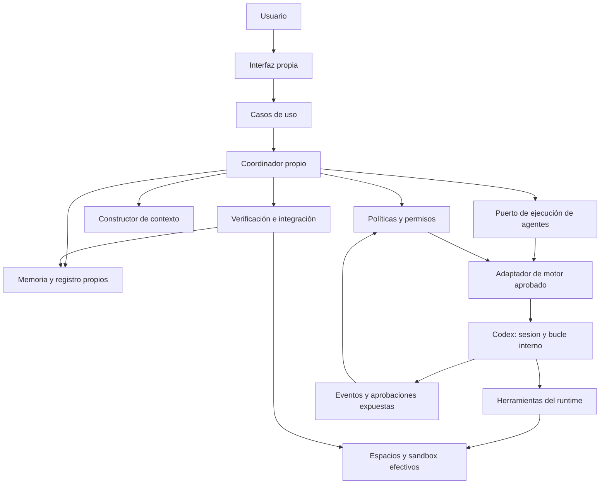

# Sistema propio de agentes con ODD

Diseño v0.7 · 23 de octubre de 2026 · Sin implementación ni validación operativa.

## 1. Objetivo y escenario

Construir un sistema propio de desarrollo asistido por IA, inspirado en Organic Driven Development de Gentleman Programming. El primer escenario confirmado por Carlos es: «Uso individual en repositorios de empresa, con posibilidad de crecer a equipo».

El sistema tendrá bajo control propio la metodología, coordinación global, memoria, políticas y evidencias. La ejecución interna de herramientas se delegará al runtime completo elegido, con controles efectivos comprobados. Gentle-AI y Engram quedan excluidos de la arquitectura. Su instalación en la máquina no constituye una dependencia del proyecto; no se desinstalan ni modifican herramientas existentes.

La independencia del sistema y la del modelo son decisiones distintas. Un proveedor de inferencia puede ser externo si la política del repositorio lo permite; también se podrá admitir un motor aprobado en infraestructura interna. No se presupone autorización para enviar código empresarial a un proveedor.

## 2. Qué tomamos de ODD

Referencia metodológica: [documentación publicada por Gentleman Programming](https://github.com/Gentleman-Programming/gentle-ai/blob/main/docs/usage.md#organic-driven-development-odd), consultada anteriormente en esta conversación. El diseño propio adopta exploración previa, trabajo proporcional, delegación justificada, continuidad y comprobación con evidencia.

Las decisiones técnicas de este documento son nuestras. No se busca reproducir todo el ecosistema ni afirmar compatibilidad con sus herramientas. El alcance continúa siendo documental.

## 3. Forma inicial del producto

Una aplicación local modular, con un solo usuario y una interfaz de terminal propia como primera entrada. La interfaz invoca casos de uso del sistema; no contiene la lógica de coordinación.

La primera versión deberá permitir iniciar una petición, consultar progreso, responder una decisión, pausar, reanudar, cancelar y revisar una entrega. Las operaciones se detallan como contratos. Carlos ha elegido Java para la aplicación y un runtime completo como motor; se propone Codex como primera integración. La base elegida es Java 25, Spring Boot 4.1.2 en modo no web y Picocli 4.7.7 para la CLI. Spring compone los componentes; las reglas de dominio se mantienen independientes. La sintaxis CLI y la distribución concreta del JDK quedan pendientes.

La aplicación se estructura por capacidades —trabajo, orquestación, contexto, memoria, políticas, ejecución y verificación— y separa reglas de dominio, casos de uso y adaptadores. Son módulos internos de un proceso; no se crean servicios distribuidos en el piloto.

## 4. Arquitectura

| Capacidad propia | Responsabilidad | Límite |
| --- | --- | --- |
| Trabajo | Petición original, requisitos, decisiones y tareas versionadas | El modelo no altera silenciosamente el objetivo |
| Coordinación | Dependencias, delegación, concurrencia, cancelación y reintentos | El proveedor no decide el estado global |
| Contexto | Selección de instrucciones, memoria y fragmentos de código | Todo contenido enviado pertenece al ámbito autorizado |
| Memoria | Progreso, decisiones, lecciones y recuperación | Una sugerencia del modelo no se convierte sola en regla |
| Políticas | Traducir restricciones a configuración y decisiones del runtime | Validación propia más cumplimiento efectivo en el runtime |
| Ejecución | Encargos, procesos, eventos y aprobaciones del runtime | Codex conserva su bucle interno y sus herramientas |
| Verificación | Comprobaciones sobre una revisión concreta | La confianza del agente no constituye prueba |

El agente principal es un rol de razonamiento. El coordinador es código Java propio que acepta o rechaza propuestas de trabajo y abre encargos en el runtime. Cada trabajador tiene una sesión de runtime identificada y devuelve resultados normalizados. En el primer piloto, el runtime no debe crear descendientes fuera del registro y presupuesto global; esta restricción deberá verificarse, no darse por lograda con un prompt.

## 5. Ciclo de trabajo

1. Registrar petición y alcance autorizado. Una consulta puede cerrarse con exploración y explicación.
2. Examinar repositorio, restricciones y contexto relevante.
3. Resolver solo dudas que impidan una decisión correcta. Una decisión de producto vuelve al usuario.
4. Elegir resolución directa o delegación y registrar el motivo. Crear seguimiento duradero cuando el trabajo lo requiera.
5. Ejecutar unidades disponibles con contexto y permisos acotados.
6. Integrar, verificar y corregir dentro del presupuesto.
7. Entregar resultados, evidencia y pendientes; conservar lo necesario para retomar.

Las decisiones ya autorizadas no requieren confirmación reiterada. Un cambio de alcance o una acción que la política reserve al usuario sí requiere una decisión concreta.

## 6. Agentes y delegación

Roles iniciales: principal, explorador, trabajador y verificador. Son instrucciones y capacidades de una ejecución, no procesos permanentes ni modelos diferentes por obligación.

Delegar para investigar una incertidumbre separable, trabajar en unidades independientes, comprobar un cambio relevante con contexto nuevo o continuar una unidad con una sesión limpia. Para tareas pequeñas entendidas se trabaja directamente.

Límites del piloto: un principal y hasta dos subagentes activos; sin subdelegación recursiva; un intento y hasta dos correcciones por tarea. Todo intento consume el mismo presupuesto global. El coordinador mantiene colas y dependencias para que una espera no agote las plazas disponibles.

Cada encargo identifica requisito, tarea, versión, base de código, ámbitos permitidos, contexto, resultado esperado y límites. Los subagentes no amplían permisos ni crean trabajo fuera del encargo.

## 7. Memoria propia

Diseño inicial: almacenamiento local transaccional para datos estructurados y archivos para evidencias voluminosas. SQLite es la elección propuesta para el primer adaptador de almacenamiento; queda detrás de un puerto propio.

Se separan cuatro tipos de información:

- Ejecución: tareas, intentos, dependencias, estados, revisiones y consumo disponible.
- Decisiones: quién autorizó qué, para qué versión y dentro de qué alcance.
- Conocimiento: hechos con procedencia y lecciones candidatas que deben aprobarse antes de aplicarse como reglas.
- Evidencia: comandos, códigos de salida, diffs, informes y referencias a artefactos.

Los ámbitos son organización, repositorio y ejecución. La recuperación no cruza ámbitos de empresa por defecto. Cada repetición del piloto tiene memoria nueva para evitar transferir soluciones.

El estado estructurado y sus eventos se actualizan en la misma transacción. Los documentos Markdown son vistas regenerables con versión; no se mantiene una segunda fuente de estado que deba sincronizarse a mano. Petición original y cambios de requisitos quedan conservados.

Antes de reanudar se reconcilian datos, procesos, revisión Git y artefactos. Un intento con resultado desconocido queda pendiente de reconciliación; no se repite automáticamente una acción con efectos.

## 8. Políticas y datos empresariales

El proyecto tendrá una política explícita por repositorio: proveedores autorizados, datos que pueden salir, rutas accesibles, herramientas, límites de ejecución y acciones reservadas al usuario. Las restricciones de organización prevalecen; un repositorio o encargo solo puede restringirlas más.

La aplicación configura los permisos requeridos y responde a las aprobaciones que el runtime expone; el sandbox y el runtime los hacen efectivos. No se presupone que cada herramienta genere una solicitud de aprobación. Un prompt de solo lectura no es aislamiento. Si no se pueden imponer las restricciones de un repositorio, ese runtime no se habilita para él.

Los secretos se obtienen por referencia desde un mecanismo autorizado; no se incorporan a prompts ni a memoria. Los registros deben minimizar contenido sensible y tener retención definida. El diseño identifica estos controles; todavía no garantiza su cumplimiento operativo.

## 9. Proveedores y motores sustituibles

Los adaptadores traducen encargos y resultados al contrato propio. Deben declarar herramientas disponibles, cancelación, recuperación, consumo observable y aislamiento efectivo.

Se elige la categoría de runtime completo: resuelve cada encargo mediante sus herramientas y bucle interno. El contrato propio conserva tareas, contexto entregado, límites, decisiones y evidencia; no sustituye cada paso interno del runtime por lógica nuestra.

Codex es la primera integración propuesta, mediante App Server por stdio y un cliente de protocolo Java detrás del adaptador. La elección de transporte y su compatibilidad con la versión instalada deben validarse. El estado propio permanece legible al cambiar de runtime; no se garantiza trasladar su sesión interna. Los detalles están en ADR-004 y ADR-006.

## 10. Aislamiento e integración

Un escritor concurrente trabaja sobre un espacio aislado creado y registrado por el sistema. Un worktree puede separar archivos, pero no impone por sí solo permisos de sistema ni aislamiento de metadatos Git.

Los cambios se devuelven como artefactos o diffs ligados a una base conocida. Solo el integrador aplica cambios al resultado conjunto. Si la base o un contrato ha cambiado, se comprueba compatibilidad y se revalida antes de integrar.

Las evidencias de aceptación se vinculan a la versión integrada. Cualquier cambio posterior invalida las comprobaciones afectadas. Un solo coordinador posee la escritura del estado de una ejecución en la primera versión.

## 11. Crecimiento a equipo

Preparar identificadores de organización, repositorio, actor y ejecución, puertos de almacenamiento y políticas, y formatos de exportación versionados. Eso permite cambiar el despliegue después sin acoplar reglas a una máquina.

La primera versión no ofrece colaboración simultánea, autenticación central, almacenamiento compartido ni coordinación distribuida. La fase de equipo requerirá identidad, autorización por recurso, concurrencia entre usuarios, recuperación de propietarios caídos y una política de datos acordada. No se resolverá compartiendo el fichero SQLite entre máquinas.

## 12. Plan por capacidades

- [x] R-01 — Definir propiedad del núcleo y escenario individual empresarial.
- [x] R-02 — Diseñar memoria propia y límites de proveedores.
- [x] R-03 — Definir contratos, controles y evolución a equipo.
- [x] R-04a — Elegir Java y runtime completo; proponer Codex como primera integración.
- [x] R-04b — Fijar Java 25, Spring Boot 4.1.2 y Picocli 4.7.7.
- [x] R-04c — Definir módulo Maven, paquetes por capacidad y contrato inicial de CLI.
- [ ] R-04d — Fijar versiones de construcción/persistencia y validar el protocolo Codex durante la preparación técnica.
- [ ] R-05 — Implementar trabajo, registro y políticas con un ejecutor simulado.
- [ ] R-06 — Demostrar recuperación, cancelación y aislamiento con fallos controlados.
- [ ] R-07 — Incorporar un motor de IA autorizado y medir delegación real.
- [ ] R-08 — Comparar modalidades sobre el producto CSV.

Las casillas completas representan diseño redactado, no implementación ni aceptación operativa. Véanse [decisiones](decisiones-entorno-odd.md), [contratos propios](contratos-sistema.md) y [piloto](piloto-odd.md).

La estructura de paquetes, los comandos y el ciclo de procesos se concretan en [estructura y CLI](estructura-y-cli.md). La primera entrega de implementación será el esqueleto Maven con ayuda y versión, seguida del registro propio y un runtime simulado.
